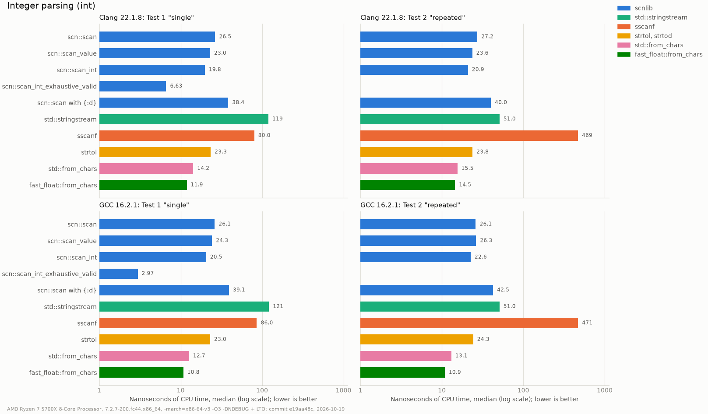
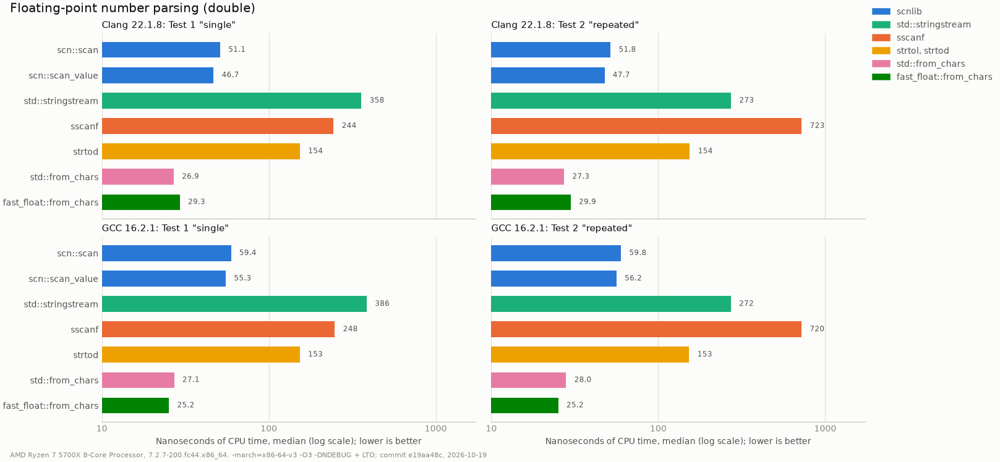
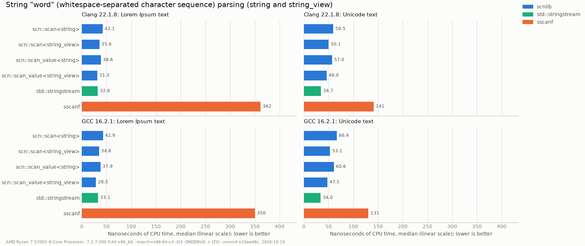
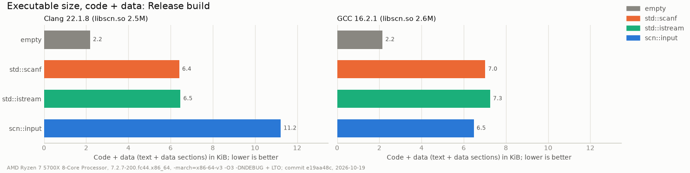
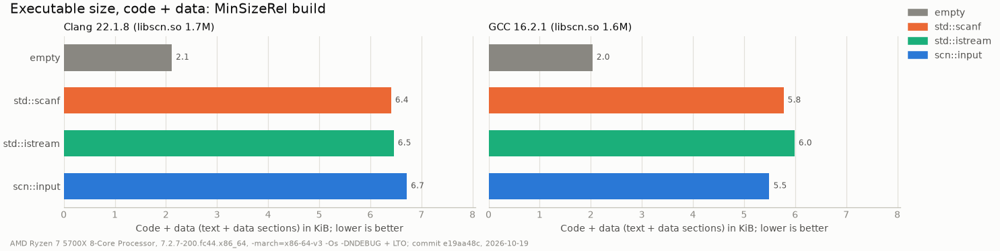
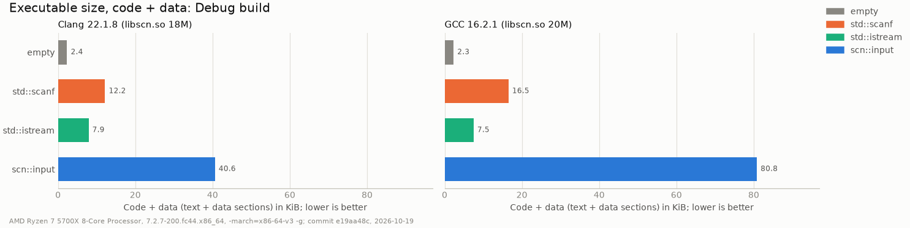

# scnlib

[](https://github.com/eliaskosunen/scnlib/actions/workflows/linux.yml)
[](https://github.com/eliaskosunen/scnlib/actions/workflows/macos.yml)
[](https://github.com/eliaskosunen/scnlib/actions/workflows/windows.yml)
[](https://github.com/eliaskosunen/scnlib/actions/workflows/arch.yml)
[](https://codecov.io/gh/eliaskosunen/scnlib)

[](https://github.com/eliaskosunen/scnlib/releases)
[](https://github.com/eliaskosunen/scnlib/blob/master/LICENSE)
[](https://img.shields.io/badge/C%2B%2B-17%2F20%2F23%2F2c-blue.svg)
[](https://scnlib.dev)

```cpp
#include <scn/scan.h>
#include <print> // for std::println (C++23)

int main() {
    // Read two integers from stdin
    // with an accompanying message
    if (auto result =
            scn::prompt<int, int>("What are your two favorite numbers? ", "{} {}")) {
        auto [a, b] = result->values();
        std::println("Oh, cool, {} and {}!", a, b);
    } else {
        std::println(stderr, "Error: {}", result.error().msg());
    }
}
```

Try out in [Compiler Explorer](https://godbolt.org/z/oG71eorvE).

## What is this?

`scnlib` is a modern C++ library for replacing `scanf` and `std::istream`.
This library attempts to move us ever so much closer to replacing `iostream`s
and C `stdio` altogether.
It's faster than `iostream` (see Benchmarks), and type-safe, unlike `scanf`.
Think [{fmt}](https://github.com/fmtlib/fmt) or C++20 `std::format`, but in the
other direction.

This library is the reference implementation of the ISO C++ standards proposal
[P1729 "Text Parsing"](https://wg21.link/p1729).

## Documentation

The documentation can be found online, at https://scnlib.dev.

To build the docs yourself, build the `scn_docs` target generated by CMake.
These targets are generated only if the variable `SCN_DOCS` is set in CMake
(done automatically if scnlib is the root project).
The `scn_docs` target requires Doxygen, Python 3.8 or better, and the `pip3`
package `poxy`.

## Examples

See more examples in the `examples/` folder.

### Reading a `std::string`

```cpp
#include <scn/scan.h>
#include <print>

int main() {
    // Reading a std::string will read until the first whitespace character
    if (auto result = scn::scan<std::string>("Hello world!", "{}")) {
        // Will output "Hello":
        // Access the read value with result->value()
        std::println("{}", result->value());
        
        // Will output " world!":
        // result->range() returns a subrange containing the unused input
        // C++23 is required for the std::string_view range constructor used below
        std::println("{}", std::string_view{result->range()});
    } else {
        std::println("Couldn't parse a word: {}", result.error().msg());
    }
}
```

### Reading multiple values

```cpp
#include <scn/scan.h>

int main() {
    auto input = std::string{"123 456 foo"};
    
    auto result = scn::scan<int, int>(input, "{} {}");
    // result == true
    // result->range(): " foo"
    
    // All read values can be accessed through a tuple with result->values()
    auto [a, b] = result->values();
    
    // Read from the remaining input
    // Could also use scn::ranges::subrange{result->begin(), result->end()} as input
    auto result2 = scn::scan<std::string>(result->range(), "{}");
    // result2 == true
    // result2->range().empty() == true
    // result2->value() == "foo"
}
```

### Reading from a fancier range

```cpp
#include <scn/scan.h>

#include <ranges>
#include <string_view>

using namespace std::literals;

int main() {
    auto result = scn::scan<int>("123"sv | std::views::reverse, "{}");
    // result == true
    // result->begin() is an iterator into a reverse_view
    // result->range() is empty
    // result->value() == 321
}
```

### Repeated reading

```cpp
#include <scn/scan.h>
#include <string_view>
#include <vector>

using namespace std::literals;

int main() {
    std::vector<int> vec{};
    auto input = scn::ranges::subrange{"123 456 789"sv};
    
    while (auto result = scn::scan<int>(input, "{}")) {
        vec.push_back(result->value());
        input = result->range();
    }
}
```

## Features

* Blazing fast parsing of values (see Benchmarks)
* Modern C++ interface, featuring
    * type safety (variadic templates, types not determined by the format
      string)
    * convenience (ranges)
    * ergonomics (values returned from `scn::scan`, no output parameters)
    * support for modules (enable target `scn::scn_module` with `SCN_MODULES` in CMake)
* `"{python}"`-like format string syntax
    * Including compile-time format string checking
      (in C++17, wrap the format string in `SCN_STRING(...)` to enable it)
* Minimal code size increase (in user code, see Benchmarks)
* Usable without exceptions, RTTI, or `<iostream>`s
    * Configurable through build flags
    * Limited functionality if enabled
* Supports, and requires Unicode (input is UTF-8, UTF-16, or UTF-32)
* Highly portable
    * Tested on multiple platforms, see CI
    * Works on multiple architectures, see Compiler support below

## Installing

`scnlib` uses CMake.
If your project already uses CMake, integration should be trivial, through
whatever means you like:
`make install` + `find_package`, `FetchContent`, `git submodule` + `add_subdirectory`,
or something else.

There are community-maintained packages available
on [Conan](https://conan.io/center/recipes/scnlib) and
on [vcpkg](https://github.com/microsoft/vcpkg/tree/master/ports/scnlib).

The `scnlib` CMake target is `scn::scn`

```cmake
# Target with which you'd like to use scnlib
add_executable(my_program ...)
target_link_libraries(my_program scn::scn)
```

See docs for usage without CMake.

## Compiler support

A C++17-compatible compiler is required. The following compilers are tested in
CI:

* GCC 7 and newer
* Clang 8 and newer
* Visual Studio 2019 (16.11, the v142 toolset), 2022, and 2026

Including the following environments:

* 32-bit and 64-bit builds on Windows
* libc++ on Linux
* gcc on Alpine Linux
* AppleClang and Homebrew Clang on macOS 15 and 26 (arm64 and x86-64), and gcc on arm64 macOS
* clang-cl with Visual Studio 2022 and 2026
* MinGW and MSys2
* Emscripten
* GCC and Clang on aarch64 Linux, and Visual Studio 2026 on arm64 Windows
* GCC on i686, armv5, armv6, armv7, aarch64, hppa, loongarch64, m68k,
  mips, mips64el, mips64r6el, powerpc, ppc64, ppc64le, riscv64, s390x, and sparc64
* Visual Studio 2022, cross-compiling to arm64

## Benchmarks

The results below were produced on 2026-10-19 (commit e19aa48c),
on an AMD Ryzen 7 5700X running Fedora 44 and Linux 7.2.7,
with Clang 22.1.8 and GCC 16.2.1 (libstdc++ for both).
The run-time benchmarks were pinned to a single core, running at a fixed 3.6 GHz.

### Run-time performance

All times below are in nanoseconds of CPU time, the median of 3 runs.
Lower is better.

#### Integer parsing (`int`)



Clang 22.1.8:

| Test                             | Test 1 `"single"` | Test 2 `"repeated"` | Test average |
|:---------------------------------|------------------:|--------------------:|-------------:|
| `scn::scan`                      |              26.5 |                27.2 |         26.9 |
| `scn::scan_value`                |              23.0 |                23.6 |         23.3 |
| `scn::scan_int`                  |              19.8 |                20.9 |         20.4 |
| `scn::scan_int_exhaustive_valid` |              6.63 |                   - |         6.63 |
| `scn::scan` with `{:d}`          |              38.4 |                40.0 |         39.2 |
| `std::stringstream`              |               119 |                51.0 |         85.2 |
| `sscanf`                         |              80.0 |                 469 |          275 |
| `strtol`                         |              23.3 |                23.8 |         23.6 |
| `std::from_chars`                |              14.2 |                15.5 |         14.9 |
| `fast_float::from_chars`         |              11.9 |                14.5 |         13.2 |

GCC 16.2.1:

| Test                             | Test 1 `"single"` | Test 2 `"repeated"` | Test average |
|:---------------------------------|------------------:|--------------------:|-------------:|
| `scn::scan`                      |              26.1 |                26.1 |         26.1 |
| `scn::scan_value`                |              24.3 |                26.3 |         25.3 |
| `scn::scan_int`                  |              20.5 |                22.6 |         21.5 |
| `scn::scan_int_exhaustive_valid` |              2.97 |                   - |         2.97 |
| `scn::scan` with `{:d}`          |              39.1 |                42.5 |         40.8 |
| `std::stringstream`              |               121 |                51.0 |         86.1 |
| `sscanf`                         |              86.0 |                 471 |          279 |
| `strtol`                         |              23.0 |                24.3 |         23.6 |
| `std::from_chars`                |              12.7 |                13.1 |         12.9 |
| `fast_float::from_chars`         |              10.8 |                10.9 |         10.8 |

#### Floating-point number parsing (`double`)



Clang 22.1.8:

| Test                     | Test 1 `"single"` | Test 2 `"repeated"` | Test average |
|:-------------------------|------------------:|--------------------:|-------------:|
| `scn::scan`              |              51.1 |                51.8 |         51.4 |
| `scn::scan_value`        |              46.7 |                47.7 |         47.2 |
| `std::stringstream`      |               358 |                 273 |          315 |
| `sscanf`                 |               244 |                 723 |          483 |
| `strtod`                 |               154 |                 154 |          154 |
| `std::from_chars`        |              26.9 |                27.3 |         27.1 |
| `fast_float::from_chars` |              29.3 |                29.9 |         29.6 |

GCC 16.2.1:

| Test                     | Test 1 `"single"` | Test 2 `"repeated"` | Test average |
|:-------------------------|------------------:|--------------------:|-------------:|
| `scn::scan`              |              59.4 |                59.8 |         59.6 |
| `scn::scan_value`        |              55.3 |                56.2 |         55.7 |
| `std::stringstream`      |               386 |                 272 |          329 |
| `sscanf`                 |               248 |                 720 |          484 |
| `strtod`                 |               153 |                 153 |          153 |
| `std::from_chars`        |              27.1 |                28.0 |         27.6 |
| `fast_float::from_chars` |              25.2 |                25.2 |         25.2 |

#### String "word" (whitespace-separated character sequence) parsing (`string` and `string_view`)



Clang 22.1.8:

| Test                           | Lorem Ipsum text | Unicode text |
|:-------------------------------|-----------------:|-------------:|
| `scn::scan<string>`            |             42.1 |         59.5 |
| `scn::scan<string_view>`       |             35.6 |         50.1 |
| `scn::scan_value<string>`      |             38.6 |         57.0 |
| `scn::scan_value<string_view>` |             31.3 |         46.0 |
| `std::stringstream`            |             32.6 |         34.7 |
| `sscanf`                       |              362 |          141 |

GCC 16.2.1:

| Test                           | Lorem Ipsum text | Unicode text |
|:-------------------------------|-----------------:|-------------:|
| `scn::scan<string>`            |             42.9 |         66.4 |
| `scn::scan<string_view>`       |             34.8 |         53.1 |
| `scn::scan_value<string>`      |             37.9 |         60.6 |
| `scn::scan_value<string_view>` |             28.5 |         47.5 |
| `std::stringstream`            |             33.1 |         34.0 |
| `sscanf`                       |              350 |          131 |

#### Basic `scn::scan` options

Clang 22.1.8:

| Test                     | Time |
|:-------------------------|-----:|
| `scn::scan`              | 17.8 |
| `scn::scan` with options | 31.4 |
| `scn::scan` with locale  | 17.8 |
| `scn::scan` localized    | 69.0 |
| `scn::scan_value`        | 13.9 |
| `std::stringstream`      | 94.8 |
| `sscanf`                 | 50.5 |
| `strtol`                 | 9.17 |

GCC 16.2.1:

| Test                     | Time |
|:-------------------------|-----:|
| `scn::scan`              | 22.9 |
| `scn::scan` with options | 34.5 |
| `scn::scan` with locale  | 23.0 |
| `scn::scan` localized    | 92.9 |
| `scn::scan_value`        | 17.5 |
| `std::stringstream`      | 97.0 |
| `sscanf`                 | 57.3 |
| `strtol`                 | 9.17 |

#### Conclusions

* For numbers, `scn::scan` is faster than `std::stringstream` and `sscanf`,
  and 2.5x to 3x faster than `strtod`.
* `std::from_chars` and `fast_float::from_chars` are about twice as fast as `scn::scan`,
  but they support fewer features.
* `scn::scan_value` is 3-13% faster than `scn::scan`.
  `scn::scan_int` is faster still, and slightly faster than `strtol`.
* `scn::scan_int_exhaustive_valid` takes 3 to 7 ns.
* Scanning an `int` with `{:d}` takes about 50% longer than with `{}`.
* When reading words, `std::stringstream` is about as fast as `scn::scan_value<string_view>`
  with the ASCII text, and faster than any of the scnlib functions with the Unicode text.
* The two compilers are about equal with integers.
  With GCC, `scn::scan` is about 15% slower with floating-point numbers,
  and about 30% slower in the basic test.

#### About

Above,

* "Test 1" refers to scanning a single value from a string,
  which only contains the text representation for that value.
  The time used for creating any state needed for the scanner is included,
  for example, constructing a `stringstream`. This test is called `"single"` in
  the benchmark sources.
* "Test 2" refers to the average time of scanning a value,
  which contains multiple values in their text representations, separated by
  spaces. The time used for creating any state needed for the scanner
  is not included. This test is called `"repeated"` in the benchmark sources.
* The string test is an exception: whitespace-separated words are read one
  after another from a sample text. "Lorem Ipsum" is ASCII-only, and "Unicode"
  is Markus Kuhn's UTF-8 demo (`benchmark/runtime/string/unicode.txt`), with
  mathematical notation, many languages and scripts, and box-drawing characters.
* The basic test scans an `int` from `"123"`.
  "With options" uses `{:i}`, "with locale" passes a `std::locale` but scans with `{}`,
  and "localized" uses `{:L}`.

The difference between "Test 1" and "Test 2" is most pronounced when using
a `stringstream`, which is relatively expensive to construct,
and adds about 70 to 115 ns.
With `sscanf`, "Test 2" is slower instead, because glibc's `sscanf` goes through
the whole remaining input on every call, and the input of "Test 2" has 8192 values.
For the same reason, the `sscanf` string results depend on the length of the text:
the Lorem Ipsum text is 64 KiB, and the Unicode text is 13 KiB.
With `scn::scan` and `std::from_chars`, there's really no state to construct,
and the results for "Test 1" and "Test 2" are thus quite similar.

The benchmarks were compiled with `-O3 -DNDEBUG -march=x86-64-v3` and LTO enabled.

The source code for these benchmarks can be found in the `benchmark` directory.
All benchmarks in this section, and the charts and tables, are produced by
`scripts/benchmark.py`. It builds with Clang and GCC, runs the benchmarks,
saves the results as JSON, and renders the charts and tables from it
(see `scripts/benchmark.py --help`):

```sh
$ python3 -m venv venv && venv/bin/pip install -r scripts/benchmark-requirements.txt
# Set the CPU frequency governor to "performance" first, and pick an idle CPU
$ venv/bin/python scripts/benchmark.py all --cpu 3
```

To run a single benchmark binary yourself, enable the CMake variable `SCN_BENCHMARKS`.
This variable is `ON` by default, if `scnlib` is the root CMake project,
and `OFF` otherwise.

```sh
$ cd build
$ cmake -DSCN_BENCHMARKS=ON \
        -DCMAKE_BUILD_TYPE=Release -DCMAKE_INTERPROCEDURAL_OPTIMIZATION=ON \
        -DCMAKE_CXX_FLAGS=-march=x86-64-v3 ..
$ cmake --build .
# choose benchmarks to run in ./benchmark/runtime/*/*_bench
$ ./benchmark/runtime/integer/scn_int_bench
```

### Executable size

All sizes below are in kibibytes (KiB). "Code + data" is the size of the
`text` and `data` sections of the compiled executable, as reported by `size`:
the machine code and the read-only and initialized data.
Debug information and symbol tables are not included.
Lower is better.

#### Release build (`-O3 -DNDEBUG` + LTO)



Clang 22.1.8:

Size of `scnlib` shared library (`.so`): 2.5M

| Method         | Code + data |
|:---------------|------------:|
| empty          |         2.2 |
| `std::scanf`   |         6.4 |
| `std::istream` |         6.5 |
| `scn::input`   |        11.2 |

GCC 16.2.1:

Size of `scnlib` shared library (`.so`): 2.6M

| Method         | Code + data |
|:---------------|------------:|
| empty          |         2.2 |
| `std::scanf`   |         7.0 |
| `std::istream` |         7.3 |
| `scn::input`   |         6.5 |

#### Minimized (MinSizeRel) build (`-Os -DNDEBUG` + LTO)



Clang 22.1.8:

Size of `scnlib` shared library (`.so`): 1.7M

| Method         | Code + data |
|:---------------|------------:|
| empty          |         2.1 |
| `std::scanf`   |         6.4 |
| `std::istream` |         6.5 |
| `scn::input`   |         6.7 |

GCC 16.2.1:

Size of `scnlib` shared library (`.so`): 1.6M

| Method         | Code + data |
|:---------------|------------:|
| empty          |         2.0 |
| `std::scanf`   |         5.8 |
| `std::istream` |         6.0 |
| `scn::input`   |         5.5 |

#### Debug build (`-g -O0`)



Clang 22.1.8:

Size of `scnlib` shared library (`.so`): 18M

| Method         | Code + data |
|:---------------|------------:|
| empty          |         2.4 |
| `std::scanf`   |        12.2 |
| `std::istream` |         7.9 |
| `scn::input`   |        40.6 |

GCC 16.2.1:

Size of `scnlib` shared library (`.so`): 20M

| Method         | Code + data |
|:---------------|------------:|
| empty          |         2.3 |
| `std::scanf`   |        16.5 |
| `std::istream` |         7.5 |
| `scn::input`   |        80.8 |

#### Conclusions

With GCC, the code using scnlib is slightly smaller than with `scanf` or `<iostream>`,
in both Release and MinSizeRel builds.
With Clang, it's about 5% bigger in a MinSizeRel build,
and about 75% bigger in a Release build, where Clang inlines more of scnlib at each call site.
In a Debug build, scnlib is 3x to 5x bigger than `scanf`,
and 5x to 11x bigger than `<iostream>`.

#### About

In these tests, 17 translation units are generated, in all of which four values
(`int`, `double`, `long long`, and a string) are read from `stdin`.
This is done to simulate a small project.
`scnlib` is linked dynamically, to level the playing field with the standard
library, which is also dynamically linked.

The code was compiled with `-march=x86-64-v3`, in addition to the flags above.
See the directory `benchmark/binarysize` for the source code.

The executables are built with the CMake variable `SCN_BENCHMARKS_BINARYSIZE`
and `BUILD_SHARED_LIBS=ON`, in Debug, Release and MinSizeRel, the latter two
with LTO. `scripts/benchmark.py all --what binarysize` builds and measures them.

### Build time

#### CPU time

Time is in seconds of CPU time (user time + sys/kernel time), the median of 3 runs.
Lower is better.

Clang 22.1.8:

| Method       | Debug | Release |
|:-------------|------:|--------:|
| empty        |  0.06 |    0.06 |
| `scanf`      |  0.18 |    0.17 |
| `<iostream>` |  0.24 |    0.23 |
| `scn::input` |  0.45 |    0.43 |

GCC 16.2.1:

| Method       | Debug | Release |
|:-------------|------:|--------:|
| empty        |  0.05 |    0.05 |
| `scanf`      |  0.29 |    0.26 |
| `<iostream>` |  0.35 |    0.32 |
| `scn::input` |  0.65 |    0.53 |

#### Memory consumption

Memory is in mebibytes (MiB) used while compiling, the median of 3 runs.
Lower is better.

Clang 22.1.8:

| Method       | Debug | Release |
|:-------------|------:|--------:|
| empty        |  74.2 |    78.3 |
| `scanf`      |   103 |     105 |
| `<iostream>` |   107 |     110 |
| `scn::input` |   125 |     125 |

GCC 16.2.1:

| Method       | Debug | Release |
|:-------------|------:|--------:|
| empty        |  23.4 |    26.6 |
| `scanf`      |  79.3 |    73.3 |
| `<iostream>` |  93.2 |    86.9 |
| `scn::input` |   139 |     124 |

#### Conclusions

Code using scnlib takes about 1.7x to 1.9x longer to compile compared to `<iostream>`.
It uses about 15% more memory than `<iostream>` with Clang, and about 45% more with GCC.
Release builds are slightly faster to compile than Debug builds, especially with GCC.

#### About

These tests measure the time it takes to compile a binary when using different
libraries.
The time taken to compile the library itself is not taken into account
(the standard library is precompiled, anyway).

The compiler flags used for a Debug build were `-g`, and `-O3 -DNDEBUG` for a
Release build.

`scripts/benchmark.py all --what buildtime` compiles the sources in
`benchmark/buildtime` and measures them. It needs GNU `/usr/bin/time`.

## Development

C++, Python, CMake and shell files are formatted with pinned formatter versions, and CI checks the formatting.

```sh
# Install the formatters
$ python3 -m venv .venv
$ .venv/bin/pip install -r scripts/format-requirements.txt
$ export PATH="$PWD/.venv/bin:$PATH"

$ python3 scripts/format.py           # format the staged files
$ python3 scripts/format.py --check   # check them without changing anything
$ python3 scripts/format.py --all     # format every tracked file

# Check the formatting before every commit
$ git config core.hooksPath .githooks
# Skip the codebase-wide reformat commits in git blame
$ git config blame.ignoreRevsFile .git-blame-ignore-revs
```

## Acknowledgements

The contents of this library are heavily influenced by {fmt} and its derivative
works.  
https://github.com/fmtlib/fmt

The design of this library is also inspired by the Python `parse` library:  
https://github.com/r1chardj0n3s/parse

### Third-party libraries

*fast_float* for floating-point number parsing:  
https://github.com/fastfloat/fast_float

*eknan* for NaN payloads:
https://github.com/eliaskosunen/eknan

*NanoRange* for a minimal `<ranges>` implementation:  
https://github.com/tcbrindle/NanoRange

## License

scnlib is licensed under the Apache License, version 2.0.  
Copyright (c) 2017 Elias Kosunen  
See LICENSE for further details.
